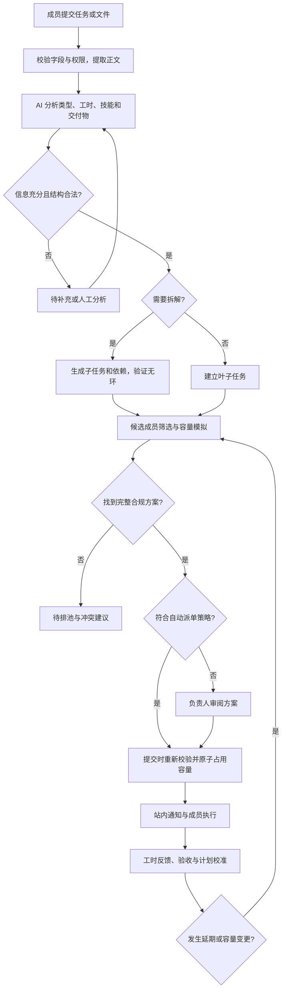

# AI Agent 项目排期管理系统 PRD

| 项目 | 内容 |
| --- | --- |
| 文档版本 | v1.0，可进入方案评审与研发拆解 |
| 编写日期 | 2026-09-29 |
| 面向客户 | 10～100 人的小型公司，典型试点团队 10～30 人 |
| 产品定位 | 将成员提交的工作需求转为可解释、可执行、受容量约束的团队排期 |
| 技术边界 | 后端 Spring Boot 3 + Java 21；Vue 3 中文 Web 前端（2026-10-07 新增交付范围） |
| 配套文档 | [技术设计 TRD](./trd.md) |
| 需求优先级 | P0：首发必须；P1：首发后增强；P2：后续探索 |

> 本次需求明确指定 Java 21，覆盖此前 JDK 8 的通用约定。本文中的容量、阈值和周期均为可评审的产品设计默认值，不是已经验证的业务效果或交付承诺。

## 1. 产品背景与目标

小公司经常由负责人凭经验分派任务：任务描述不完整、跨项目争用同一个同事、长任务无法判断进度、插单导致后续工作整体延误。普通任务清单只能记录负责人，不能回答“谁有能力接、哪一天能接、接了会影响什么”。

本系统以任务为输入，以成员技能、公司工作日历、每日容量和任务依赖为约束，输出任务拆解、工时估算、建议负责人和逐日排期。AI 负责理解和建议，确定性的排期引擎负责硬约束校验，最终结果能够解释、调整、回溯。

### 1.1 产品目标

1. 成员可以通过表单、文件和批量导入提交任务，减少负责人整理需求的时间。
2. 把大型任务拆成有交付物、有验收标准、可分派的子任务，并建立依赖关系。
3. 为合格成员分配任务，并在每天的容量范围内预留工作量。
4. 某成员当日排满时禁止继续分配，优先寻找其他具备技能且有容量的同事。
5. 无法安排时明确展示原因、最早可执行日期和可选处理方案，禁止虚构排期。
6. 通过任务列表、成员排期和冲突中心，让负责人快速判断项目能否按时完成。

### 1.2 首发效果指标

以下为试点目标，需在上线前记录人工排期基线，并在试点四周后评估。

| 指标 | 定义 | 试点目标 |
| --- | --- | --- |
| 超容量分配 | 已提交排期中成员日期占用超过有效容量的记录数 | 0，发布阻断指标 |
| 非法依赖排期 | 已提交排期中后置任务违反前置完成约束的记录数 | 0，发布阻断指标 |
| 排期耗时 | 提交完整需求至产生可审阅方案的人工参与分钟数 | 相比基线降低 50% |
| 方案采纳率 | 未修改负责人和工时即采纳的叶子任务数 / 已审阅叶子任务数 | ≥60%，按任务类型分组 |
| 工时偏差 | 完成任务的 `abs(实际工时−计划工时)/max(计划工时,0.5h)` 中位数 | 有不少于 30 个样本后评估，目标 ≤30% |
| 及时预警 | 发现容量或依赖变更后 1 分钟内生成有效冲突事件的比例 | ≥99%，不含外部渠道投递时间 |
| 自动化覆盖 | 自动提交的合规排期任务数 / 符合自动派单条件的任务数 | 单独观察，不以提高覆盖率牺牲硬约束 |

## 2. 范围与版本规划

### 2.1 P0 首发范围

- 公司、成员、项目、角色、技能标签、项目参与范围、工作日历和每日容量。
- 任务表单、Markdown/TXT/DOCX/可提取文本的 PDF 附件、CSV 模板批量导入。
- AI 补全、分类、三点工时估算、大任务拆解、依赖建议、理由说明。
- 成员能力筛选、逐日容量分配、满额自动换人、无解进入待排池。
- 自动派单与人工确认两种项目策略；默认人工确认，配置后可自动派单。
- 任务列表、成员日/周/月排期、任务详情、冲突中心、项目概览。
- 人工调整、锁定排期、版本化方案、基础变更审计、站内通知。
- 实际工时、剩余工时、完成验收、延期影响分析。

### 2.2 P1 增强范围

- What-if 排期沙盘：模拟加人、延期、调整优先级，比较影响后一次提交。
- 历史工时校准、项目风险周报、关键路径、技能瓶颈和单点依赖提示。
- 企业微信/飞书/钉钉通知与待办卡片；先打通一个渠道。
- 常用任务模板、重复任务、跨项目资源预算、外部只读访客。
- 小时级时间段排期、同日依赖衔接、外部日历同步。

### 2.3 P2 / 明确不纳入首发

- 自动执行研发、设计或销售任务的通用 Agent。
- 自动绩效评级、工资结算、工时监控截图、员工隐私推断。
- 多人同时占用同一个叶子任务；首发拆为不同角色的协作子任务。
- 跨公司人员借调、完整 HR/CRM/财务系统、对外项目报价。
- 任意网页自动抓取、附件内代码执行、复杂扫描件 OCR、电子表格任意格式识别。
- 数学意义上的全局最优排期保证；首发提供可解释的可行方案。

## 3. 用户与权限

一个用户可加入多个公司；每次请求只在当前公司的授权范围内操作。项目权限进一步收窄公司角色权限。

| 操作 | 公司管理员 | 项目负责人 | 普通成员 |
| --- | --- | --- | --- |
| 管理成员、角色、公司日历、AI 策略 | 是 | 否 | 否 |
| 设置成员标准容量、批准容量调整 | 是 | 仅被授权管理的成员 | 否，可提交申请 |
| 设置技能等级 | 是 | 可认证项目所需技能 | 可自报，待认证 |
| 建立和管理项目 | 是 | 被授权项目 | 否 |
| 提交任务 | 是 | 是 | 是，限可参与项目 |
| 查看任务详情与附件 | 按项目授权；紧急访问须审计 | 本项目 | 本人负责/提交或项目可见范围 |
| 查看团队负载 | 是 | 本项目及脱敏跨项目占用 | 本人；团队汇总可配置 |
| 批准拆解、调整人员与排期 | 是 | 本项目，受人员资源权限限制 | 不可直接改派，可提出建议 |
| 更新执行状态和工时 | 可代填并留痕 | 可代填并留痕 | 本人负责的任务 |
| 关闭冲突与取消任务 | 是 | 本项目 | 本人未提交的草稿可删除 |

跨项目资源占用向无权限用户仅显示“其他项目占用 3h”，不能泄露任务标题、客户、附件或人员私人请假原因。管理员也不能通过排期权限默认获得全部附件读取权限。

## 4. 关键概念与口径

| 概念 | 定义 |
| --- | --- |
| 原始需求 / 父任务 | 对业务目标的描述，可聚合多个子任务；汇总节点不占容量 |
| 叶子任务 | 最小可分配工作单元，只有一个负责人，可跨多天安排 |
| 预估工时 | 完成工作所需投入，例如 12 小时，不等于 12 小时后交付 |
| 任务周期 | 从预计开始日到预计完成日的日历跨度，包含等待、周末和依赖时间 |
| 标准工时 | 成员正常工作日时长，默认 8h |
| 每日任务容量 | 可用于本系统任务的时长，默认 6h，预留会议、沟通等时间 |
| 日期可排容量 C | 基于每日任务容量、节假日、请假及额外不可用时长得到的当日上限 |
| 日期占用 U | 该成员该日期所有项目已提交的预留工时，以及为防止重复利用而保留的当日/历史工时 |
| 剩余容量 R | `C−U`；任何新增或调整后都必须满足 `0≤U≤C` |
| 排期片段 | 叶子任务在某成员某日期预留的工时，例如周一 3h、周二 2h |
| 待排池 | 需求已明确，但没有完整可执行方案的任务集合 |
| 排期方案 | 不占容量的模拟结果，只有提交成功后才形成真实分配 |
| 锁定排期 | 负责人要求自动重排不改变的人选/日期/工时；仍受容量与依赖硬约束限制 |

### 4.1 时间和容量默认值

| 配置 | 默认值 | 规则 |
| --- | --- | --- |
| 公司时区 | Asia/Shanghai | 日期按公司时区解释；首发一个公司一个时区 |
| 工作日 | 周一至周五 | 节假日和调休由管理员维护并发布，不假定每周末都休息 |
| 计划粒度 | 30 分钟 | 计划工时向上取整，容量向下取整；数据库用整数分钟 |
| 展示粒度 | 日期 | 首发不承诺具体几点执行 |
| 每日容量 | 6h | 按成员可改；不得大于该成员标准工作时长 |
| 排期搜索范围 | 未来 60 个日历日 | 最大 180 日；到边界仍无解则待排 |
| 单叶子任务建议规模 | 0.5～16h | 超过阈值触发拆解；确实不可拆可审批跨日执行 |
| 大任务拆解触发 | >16h，或 ≥3 种交付角色，或用户主动要求 | 由规则触发，AI 生成候选拆解 |
| 单次拆解限制 | 深度 ≤3，叶子任务 ≤30 | 超限分阶段处理，禁止无限递归 |
| 自动派单风险缓冲 | 20% | 计入计划工时，不能重复扣容量；可按任务类型配置 |
| 重排冷却 | 同任务 30 分钟 | 紧急失效事件不受冷却限制；普通自动改派每日最多 2 次 |

普通工作日 `C=floor30(min(每日容量, max(0,标准工时−请假时长))−额外不可用时长)`，结果小于 0 时取 0。预留在默认 6h 以外的常规会议不重复扣减；额外不可用指超出该预留的会议等。休息日容量为 0，管理员明确设为调休工作日后才可排期。容量修改须重新校验受影响日期。

### 4.2 首发日级依赖的明确限制

首发支持“完成后开始”（FS）依赖。若前置任务预计周一完成，后置任务最早从周二起，在后置负责人的第一个可工作日期排期。即使两人周一均有空闲，也不声称支持同日衔接。若需要小时级协作，进入 P1 时间段排期。任务实际开始时，还必须检查所有前置任务已经验收完成。

## 5. 核心业务流程

## 6. 任务上传与需求整理（P0）

### 6.1 新建任务

必填：项目、标题、需求描述或可解析的附件。选填：任务类型、期望截止日期、截止类型、优先级、预估工时、指定/偏好成员、关联任务、技能要求、验收标准、外部链接。

- 截止类型分为硬截止与期望截止，默认期望截止；不能由 AI 把期望截止升级成硬截止。
- 硬指定负责人表示只能由该成员承担；偏好负责人允许容量不足时自动换人。界面必须明确区分。
- AI 可以建议优先级，只有管理员/负责人可以批准 P0 紧急等级。
- 业务任务优先级为 P0 紧急、P1 高、P2 普通（默认）、P3 低；与本文功能版本的 P0/P1/P2 范围标记是两套独立概念。
- 缺少验收标准时可由 AI 草拟，标为“建议”；未确认的关键假设不得作为自动派单依据。
- 用户可以保存草稿，提交后生成稳定任务编号，原始输入与后续 AI 版本分别保存。
- 任务内容和附件作为分析资料，文档中出现“忽略规则并给某人派单”等文字不能获得系统指令权限。

### 6.2 上传与批量导入

- 单文件 ≤20MB，每任务 ≤5 个附件；支持 TXT、MD、DOCX、文本 PDF。PDF 无可提取文本时明确提示，允许用户手动补充正文。
- 上传后显示扫描/解析中、成功或失败；解析失败可保留文件作为人工附件，但不得假装已理解。
- CSV 首发模板字段：`client_key,title,description,task_type,estimate_hours,due_date,due_type,priority,preferred_member_code,dependency_client_keys`。
- 单次 ≤200 行，先预览再确认；显示行号与错误，非法依赖、重复键和跨项目引用禁止提交。
- 首发批次要求全部行校验通过后整体入库；重复确认不重复建任务。
- 不默认抓取外部链接内容；外部链接仅作参考，避免权限和内容来源不明。

## 7. AI 分析与工时估算（P0）

AI 输出包括：任务类型、需求摘要、交付物、验收标准、必需/加分技能及等级、乐观/最可能/悲观工时、假设、缺失信息、复杂度、置信度、是否拆解及理由。

1. 先理解任务本身的标准工时，再评估不同合格成员对应的计划工时。
2. 三点估算：`基础工时=(乐观+4×最可能+悲观)/6`，所有数值必须非负且有序。
3. 首发成员效率系数统一为 1.0；不凭技能标签主观断言某员工效率更高。P1 才在足够历史样本下启用有边界的个人/类型校准。
4. `计划工时=向上取整到0.5h(基础工时×成员校准系数×(1+风险缓冲比例))`。人工确认最终工时时直接采用最终值，不再二次加缓冲。
5. 输出“预计投入”和“预计起止日期”两个字段，不把投入工时直接写成项目周期。
6. 无历史数据时注明“冷启动估算”，人工给定估算和任务模板优先作为证据。
7. AI 自报置信度仅为一项信号。系统同时检查字段完整性、估算区间宽度、技能可映射性、假设确认情况与模型输出合法性。

### 7.1 自动派单准入

项目须明确开启自动派单，且同时满足：

- 信息完整、验收标准已明确、无未确认的关键假设；
- 叶子任务技能能映射到已认证技能目录，硬约束全部通过；
- 系统质量分 ≥0.80，悲观/乐观工时比 ≤2.5；首次大任务拆解须人工确认，确认后可按项目策略自动提交排期；
- 普通新增任务或未开始、未锁定任务的自动重排；
- 不造成现有任务延后、不改变进行中任务负责人、不影响已锁定任务；
- 无硬截止违约，不需要提高容量或安排休息日工作。

不满足准入只影响自动提交，仍可生成方案供负责人审阅。模型不可用时允许人工填写工时和技能，继续使用容量排期。

## 8. 大任务拆解与依赖（P0）

### 8.1 拆解原则

- 每个子任务都有标题、范围、交付物、验收标准、工时、技能和前置任务。
- 拆解围绕可交付结果，如“登录接口与自动化测试”，避免“进行开发”这类不可验收描述。
- 串行约束用依赖边表示，可并行工作不强行串联。
- 一个叶子任务只有一个负责人；设计、开发、测试等不同职责拆开，各自占容量。
- 父任务仅汇总，不和子任务重复占容量；父任务总工时等于叶子计划工时之和。
- 拆解前后估算差异超过 20% 时提示复核，不强行把子任务工时压回原估算。
- 支持添加、删除、合并子任务与依赖；一旦执行开始，变更必须保留版本与已发生工时。

### 8.2 依赖规则

- 首发仅支持同项目叶子任务之间的 FS 依赖；跨项目依赖作为外部阻塞说明，待后续版本支持。
- 禁止自依赖、循环依赖、跨公司依赖和指向已删除任务的依赖。
- 前置取消不等于完成；后置进入阻塞，由负责人决定取消后置、替换依赖或调整需求。
- 前置延期必须计算所有后继的影响，不仅检查直接后继。
- 前置提前完成时可提出提前方案；锁定任务不自动提前。
- 父任务硬截止约束整棵子任务树；所有必需叶子须不晚于该截止完成。叶子有更早硬截止时取更早者，不能通过拆解丢失原需求期限。
- 子任务分别选择人选、日期和工时，但首发同一拆解树的首次排期整体提交；任一必需子任务无解，整棵树保持待排并展示模拟结果，避免半套计划被误认作交付承诺。

### 8.3 示例：小型后台模块

以下为已经确认、包含缓冲的计划工时，周一至周五工作，所有成员每日容量 6h。

| 子任务 | 负责人 | 计划工时 | 依赖 | 排期 |
| --- | --- | --- | --- | --- |
| A 需求与验收标准 | 产品甲 | 4h | 无 | 周一 4h |
| B 接口开发 | 后端乙 | 10h | A | 周二 6h、周三 4h |
| C 页面实现 | 前端丙 | 8h | A | 周二 6h、周三 2h |
| D 联调 | 后端乙 | 4h | B、C | 周四 4h |
| E 验收测试 | 测试丁 | 6h | D | 周五 6h |

父任务合计 32h，预计周期周一至周五，共 5 个日历日。B、C 并行；D 不在周三插入，遵守首发日级依赖规则。实际执行时，若 A 尚未验收，B、C 即使到了周二也不能开始。

## 9. 技能匹配、容量排期与自动改派（P0）

### 9.1 成员能力模型

每位成员维护岗位、已认证技能、技能等级 1～5、可参与项目、任务类型偏好、标准工时、每日容量、请假/休息日、是否接受自动派单。自报技能不直接成为关键技能准入依据，需认证。

“接受自动派单”和“接受新任务”分开设置：关闭自动派单后仍可由负责人手动选择，但须满足全部硬约束；突发离岗关闭接受新任务后，自动与人工均禁止新增，恢复可用状态后再分配。

必需技能全部满足才可进入候选集。例如任务要求 Java≥3、SQL≥2，成员只满足 Java 不得因“今天有空”而被分配。没有候选人时显示技能缺口，不能静默降低要求。

### 9.2 派单顺序

1. 校验需求、依赖、工时和项目资源权限。
2. 筛选在职、可参与项目、接受自动派单、满足必需技能且日期可用的成员。
3. 按优先级、硬截止紧迫程度、依赖关键程度及提交时间确定任务顺序，保证相同输入结果稳定。
4. 计算各候选人的完整跨日可行方案，遵循每日容量和依赖约束。
5. 当前偏好成员当日满额时，优先选择同日可启动且整体可行的其他合格成员；不能仅因其更熟练而继续占用满额日期。
6. 同日无人可行时，比较其他日期的完整方案；在硬截止前找到方案则允许跨日安排。
7. 对可行方案综合技能匹配、完成时间、负载均衡、切换成本和成员偏好评分，返回最多 3 个备选及理由。
8. 提交时重新检查实时容量；并发竞争失败时刷新并重算，不使用旧方案强行写入。

### 9.3 硬规则

- 每日容量是跨项目共享上限；不能在每个项目分别计算一遍容量。
- 管理员、人工拖拽、紧急任务、AI 自动派单走相同的校验，均不能超配。
- 计划只覆盖完整叶子任务工时，首发不提交半个叶子任务的占用。
- 首发一个叶子任务跨日仍由同一成员完成，不自动每天换负责人。
- 休息日、已批准全天请假日、离职后的日期禁止分配。
- 新任务不能自动挤走已承诺任务。紧急插单先模拟移动哪些未开始任务，负责人确认后整体替换。
- 系统不能自行增加容量、批准加班或提高成员技能等级。
- 硬截止无解进入待排；期望截止无解可产生延期方案，但必须标红并人工确认。
- 人工硬指定人员且无容量时显示“指定人员不可用”，不擅自换人。

### 9.4 满额改派示例

| 条件 | 结果 |
| --- | --- |
| 张三容量 6h，已排 6h；李四容量 6h，已排 3h；两人均合格；新任务 2h | 排给李四，李四占用变为 5h；张三保持 6h |
| 两人今天均满，李四明天有 2h，且任务硬截止是明天 | 排到李四明天；明确显示顺延原因 |
| 李四有空但必需技能不达标，张三已满 | 不派给李四；寻找后续可行日期，否则待排 |
| 新任务 8h，李四今天剩 2h、明天剩 6h | 同一叶子可排今天 2h、明天 6h，前提是依赖和截止允许 |
| 张三被硬指定，今天满额，硬截止今天 | 禁止提交，提示改截止、调整其他未开始任务或解除指定 |
| 两个请求同时抢李四最后 2h | 最多一个提交成功，另一个重算或待排 |

### 9.5 已开始任务与剩余工时

- 成员记录实际工时和预计剩余工时；实际工时用于事实记录，不与计划占用再次相加。
- 当天已开始任务的当日预留默认保留至当天结束；完成得早不会自动把同一时间重复卖给其他任务。
- 完成或取消任务可释放未来日期的预留；未开始的当日片段可以在明确取消/改派后释放。
- 截至日终仍未做完的工作，根据成员确认的剩余工时重新安排；不直接用“计划−实际”推断完成度。
- 剩余工时增加时，不修改已经发生的历史记录；先计算未来容量及后继影响。
- 进行中任务变更负责人必须由负责人确认，并增加交接子任务或显式交接工时。
- 实际投入可能超过计划，应如实记录并告警；“禁止超配”约束的是系统承诺排期，不篡改实际工作事实。

## 10. 日历、请假和容量变更（P0）

1. 标准容量可按成员设置，单日覆盖须说明原因；超过标准工作时长的申请拒绝。
2. 未来请假/日历修改先展示影响任务，再在同一事务内释放、改派或移入待排，全部符合新容量后才生效。
3. 已锁定任务受影响时，不静默解锁；负责人明确选择解除锁定并重排，或取消本次容量变更。
4. 当天已开始/已保留工时不得被直接删除。若新容量低于这些保留占用，拒绝容量下调并解释；可先停止接受新任务，将后续日期设为请假，再处理可移动部分。
5. 突发离岗可立即设“停止接受新任务”，不会抹掉当天历史；未开始的未来任务进入改派流程。
6. 已过去日期的容量快照不可随公司默认容量变化而重写。
7. 调休、半天假、多项目占用均进入同一个容量账本。

## 11. 状态与工作流（P0）

业务状态和排期状态分开，避免“已排期”被误解为“已经开始”。

| 业务状态 | 进入方式 | 后续 |
| --- | --- | --- |
| DRAFT 草稿 | 新建未提交 | 提交或删除 |
| SUBMITTED 待分析 | 提交成功 | 待补充或准备就绪 |
| NEEDS_INFO 待补充 | 字段/关键假设缺失 | 补全后重新分析 |
| READY 可执行准备 | 分析确认，无业务阻塞 | 排期后开始；或取消 |
| IN_PROGRESS 进行中 | 负责人开始，前置已完成且当前计划有效 | 阻塞、待验收、取消 |
| BLOCKED 阻塞 | 外部原因、依赖失效、成员报告 | 解除阻塞后返回原阶段 |
| IN_REVIEW 待验收 | 成员提交交付物 | 验收完成或退回进行中 |
| DONE 已完成 | 指定验收人确认 | 受控重开，保留旧版本 |
| CANCELED 已取消 | 负责人确认 | 终态；需再次开展则复制新任务 |

排期状态：`UNSCHEDULED`（无完整计划）、`PLANNED`（完整且有效）、`STALE`（计划受变更影响，禁止按旧计划新开工）、`CLOSED`（完成/取消，无未来占用）。提交中、分析失败是作业状态，不作为业务状态。

叶子开始条件：本人或有权限的代操作人、业务 READY、排期 PLANNED、当前日期有该任务片段、全部前置 DONE。父任务状态按子任务聚合，只要有未完成叶子就不能显示整体完成。父任务进度按首次确认的叶子工时权重计算，并明确反映后续范围变更，不能用已记录工时伪造进度。

## 12. 页面与交互需求

2026-10-07 用户追加前端系统需求，已将 Vue 3 中文管理界面纳入交付。以下保留完整产品规划；当前已实现的页面、限制及验收方式以 [前端说明](docs/frontend.md) 为准。

### 12.1 工作台

- 我的今日任务、剩余容量、待补充需求、待验收任务和阻塞事项。
- 负责人看到待审阅方案、待排任务、即将逾期任务和近期成员负载。
- 所有风险卡片可直接定位任务或冲突，避免只有数字没有处理入口。

### 12.2 任务列表

- 列：编号、标题、项目、父子层级、类型、优先级、业务/排期状态、负责人、计划/实际/剩余工时、起止日、截止日、风险、更新时间。
- 筛选：项目、成员、技能、状态、日期、未分配、超期、AI 待审阅；支持组合筛选和保存视图。
- 父子折叠、分页排序、批量分析/排期/取消；批量变更展示每项结果和失败原因。
- 展示“AI 建议”“人工确认”“自动提交”来源，不能把待确认方案显示成已派发。

### 12.3 任务详情

- 需求正文、附件、估算依据、假设、子任务、依赖关系、当前及历史排期。
- 人选解释：技能命中、可用容量、预计完成、替代方案、未选其他人的主要原因。
- 交付物、验收清单、实际工时、剩余工时、阻塞原因、评论与审计时间线。
- “重新分析”生成新版本，不能直接覆盖已执行计划；明确显示差异。

### 12.4 成员排期视图

- 行为成员，列为日期，支持日/周/月查看；月视图可显示汇总热力格。
- 单元格显示 `已占用/有效容量`，颜色：0～<80% 正常、80～<100% 接近满额、100% 满额；另用图标/文字表示休息或请假。
- 展示跨日任务、父子关系、计划锁定、阻塞和其他项目脱敏占用。
- 拖拽/改负责人先调用模拟校验；失败恢复原位置并解释原因，成功提交后刷新版本。
- 未提交方案使用虚线样式，与已占容量的正式计划区别展示。
- 空状态区分没有成员、没有任务、筛选无结果；AI 失败不影响查看现有排期。

### 12.5 冲突中心

- 列表含冲突类型、严重级别、影响任务/成员/日期、触发事件、可执行建议、处理人、状态。
- 生命周期：OPEN → ACKNOWLEDGED → RESOLVED；条件仍存在时禁止仅点按钮“已解决”。
- 同一个根因聚合展示，依赖链影响合并通知；条件再次出现可重新打开并留痕。
- 解决方案先预览“谁、哪天、增加/减少多少工时、哪些截止受影响”，再提交。

## 13. 冲突分类与处理规则

| 类型 | 级别 | 阻止提交 | 可执行建议 |
| --- | --- | --- | --- |
| CAPACITY_FULL 容量不足 | 高 | 是 | 换合格成员、顺延、调整其他未开始任务 |
| NO_SKILL_MATCH 技能无人满足 | 高 | 是 | 指定合格人员、拆分职责、经确认修改需求 |
| HARD_DEADLINE_UNREACHABLE | 高 | 是 | 修改硬截止、缩减范围、增加合格资源 |
| SOFT_DEADLINE_RISK | 中 | 自动提交阻止，人工可确认 | 接受延期并通知相关人员 |
| DEPENDENCY_CYCLE / INVALID | 高 | 是 | 修改依赖 |
| PREDECESSOR_DELAYED | 高 | 对受影响新开工阻止 | 重算全部后继，锁定影响需人工决定 |
| MEMBER_UNAVAILABLE | 高 | 是 | 改派未开始任务、停止新任务接收 |
| LOCKED_PLAN_IMPACT | 高 | 是 | 有权限者明确解锁或放弃变更 |
| ESTIMATE_LOW_CONFIDENCE | 中 | 自动提交阻止 | 补充描述、人工确认估算 |
| PLAN_VERSION_STALE | 中 | 是 | 刷新当前数据并重新模拟 |
| SEARCH_HORIZON_EXCEEDED | 中 | 是 | 扩大搜索范围或分阶段规划 |
| ACTUAL_OVERRUN | 中 | 不阻止事实记录 | 更新剩余工时和未来排期 |

“增加资源”仅指组织允许增加符合条件的人员；系统不能把同一成员上限自行调高。硬截止、技能要求和锁定是不同约束，不提供绕过全部规则的“强制提交”按钮。

## 14. 排期解释、通知与审计

### 14.1 可解释派单

每份方案保存任务输入版本、技能和容量快照、算法版本、AI 模型与提示模板版本、主要规则命中结果及最终确认人。面向用户展示可验证的简要依据，例如：“李四满足 Java 3 级要求，周三余量 3h，可承接 2h；张三周三已满 6h”。不展示或依赖模型隐藏推理过程。

### 14.2 站内通知（P0）

触发：首次派单、负责人变化、日期变化、补充信息请求、待验收、阻塞、截止风险、容量变更影响。仅在事务提交成功后发送；批量重排按成员和项目聚合，避免同一依赖链轰炸。相同事件幂等，不因重试重复通知。

普通摘要默认在工作时段展示，高风险冲突立即生成站内通知。P1 外部消息只发送摘要和链接，不默认包含附件正文。通知有已读状态，投递失败不回滚已经成功的排期。

### 14.3 审计

记录人员、时间、对象、操作、原因、前后差异、关联方案及请求编号。任务改派、容量变化、技能认证、模型策略、锁定/解锁、验收、取消必须留痕。历史计划可查看；恢复旧方案必须重新模拟，不能直接覆盖当前容量。

## 15. 增强功能设计

| 功能 | 用户价值 | 边界与优先级 |
| --- | --- | --- |
| 排期沙盘 | 回答“提前两天上线需要怎样调整” | P1；模拟不占容量，确认后再次校验 |
| 单点技能风险 | 提醒只有一人掌握关键技能 | P1；建议培养备份，不直接判定绩效 |
| 估算回顾 | 找出经常低估的任务类型 | P1；小样本不生成个人结论 |
| 任务模板 | 常见需求自动带验收项、依赖和技能 | P1；模板需版本化，可人工修改 |
| 交付信心摘要 | 解释项目截止风险来自哪里 | P1；输出风险等级和证据，不伪称精确概率 |
| 每周计划摘要 | 汇总完成、延期、阻塞、下周容量 | P1；优先聚合，减少手工周报 |
| 最低沟通成本 | 尽量保持同一模块负责人连续性 | P0 评分因素；不能覆盖容量/技能约束 |

## 16. 非功能需求

- **一致性**：所有入口统一执行容量和权限校验；网络重试不重复创建和派单。
- **性能目标**：100 活跃成员、20,000 历史任务、2,000 活跃叶子任务规模下，普通查询 P95≤500ms；50 叶子/60 日排期模拟 P95≤3s（不含模型耗时）。
- **AI 体验**：异步处理，返回进度；标准文本分析目标 P95≤60s，超时明确提示并提供重试/人工处理。
- **可用性目标**：正式生产月度 99.5%；单机试点不宣称高可用，需监控与恢复机制。
- **可访问性**：状态不只靠颜色区分；支持键盘操作和清晰错误信息。
- **安全**：公司隔离、项目授权、附件鉴权、上传安全检测、敏感数据最小化发送模型。
- **数据保护**：模型供应商、数据驻留、保留周期和预算由公司管理员配置；历史工时不得用于未经授权的员工排名。
- **可恢复性**：计划、任务、容量和审计可备份恢复；恢复后先校验容量账本再恢复派单。

## 17. 验收场景

| 编号 | 场景 / Given | 操作 / When | 预期 / Then |
| --- | --- | --- | --- |
| AC-01 | 成员有项目权限，表单合法 | 提交任务 | 生成唯一编号，异步分析，原始输入可追溯 |
| AC-02 | CSV 同批次重复点击确认 | 再次确认 | 只入库一次，返回原批次结果 |
| AC-03 | 张三今日 6/6h，李四 3/6h，均合格 | 自动排入 2h 任务 | 张三不变，李四 5/6h，记录改选理由 |
| AC-04 | 所有合格成员今日满额且硬截止今天 | 派单 | 无容量写入，任务待排，显示截止无解 |
| AC-05 | 有空闲者缺必需技能 | 派单 | 不分给不合格成员，显示技能缺口 |
| AC-06 | 成员每日 6h，任务 10h，无依赖 | 排期 | 同一成员跨两天占用 6h+4h |
| AC-07 | 32h 示例大任务 | 分析并确认 | 生成 5 叶子和正确依赖，父节点不占用，合计 32h |
| AC-08 | A→B→C，尝试 C→A | 保存依赖 | 拒绝并展示环路，原依赖不变 |
| AC-09 | 前置周一预计完成 | 模拟后置 | 后置不早于周二的可工作日 |
| AC-10 | 前置未验收，后置到了计划日期 | 点击开始 | 拒绝开工并提示依赖未完成 |
| AC-11 | 剩 2h，两个并发请求各 2h | 同时提交 | 至多一个成功，无超容量和重复占用 |
| AC-12 | 负责人手动拖入已满日期 | 提交调整 | 拒绝并恢复展示，管理员也不能绕过 |
| AC-13 | 未来请假影响已排任务 | 确认日历变更 | 任务改派或待排与容量变化原子生效，无新超配 |
| AC-14 | 今日已保留 4h，新容量仅 2h | 下调容量 | 拒绝直接下调，保留历史并给出处理建议 |
| AC-15 | 已锁定任务被新方案影响 | 自动重排 | 不擅自解锁，产生人工处理冲突 |
| AC-16 | 模型超时/返回非法 JSON | 分析 | 有限重试后明确失败，可人工填值继续排期 |
| AC-17 | 同一成员参与两个项目 | 第二项目排期 | 共用容量，未授权详情脱敏 |
| AC-18 | 任务提前完成且明日有预留 | 验收完成 | 明日预留释放，今日已开始片段保留，实际工时不重复占用 |
| AC-19 | 方案生成后容量已改变 | 确认旧方案 | 返回版本过期，要求重算，不覆盖新计划 |
| AC-20 | 用户尝试访问其他公司任务 | 列表、详情、附件下载 | 全部拒绝或不返回，无存在性泄露 |
| AC-21 | 大任务一个必需子任务无解 | 首次排期 | 全树不提交，展示卡点和其余模拟结果 |
| AC-22 | 前置延期影响多个后继 | 重排 | 全部后继被检查，旧计划不能继续新开工 |
| AC-23 | 硬指定张三且张三无容量 | 自动派单 | 不擅自换人，保留待排和建议 |
| AC-24 | 重排请求或通知被重复消费 | 执行重试 | 计划版本与通知只生效一次 |

## 18. 交付节奏与范围管理

以下为需求完整、人员到位前提下的粗略计划，不是系统承诺自动生成的项目交付日期。建议配置后端 2 人、产品/测试各 0.5～1 人；前端工作单独估算，未包含在以下后端工作量内。

| 阶段 | 建议时长 | 完成标准 |
| --- | --- | --- |
| 规则确认与模型样本准备 | 1 周 | 确认容量、技能、状态、人工确认策略及验收样例 |
| 基础任务与组织能力 | 1～2 周 | 权限、任务、附件、技能、日历、基础接口可用 |
| 排期引擎与容量事务 | 2 周 | 满额改派、跨日、依赖、并发验收通过 |
| AI 分析与拆解 | 1～2 周，可部分并行 | 有限重试、结构校验、降级、版本记录完成 |
| 冲突、审计、通知与试点 | 1～2 周 | 核心链路联调、压测、权限测试、恢复演练通过 |

整体后端首发建议预留 6～9 周，具体由团队能力和既有基础设施重新估算。P0 容量一致性和权限隔离不因赶进度裁剪；可先延后批量导入或复杂附件解析。

## 19. 评审待确认项与可执行默认值

| 待确认 | 本文默认值 | 影响 |
| --- | --- | --- |
| 首批公司人数和并发 | 10～30 人试点，设计上限 100 人 | 容量与压测基线 |
| 采用哪个模型服务 | 后端适配可替换，供应商待选 | 数据驻留、成本、延迟 |
| 默认是否自动派单 | 人工确认；项目开启后符合准入可自动提交 | 上线信任和误派风险 |
| 每日容量与缓冲 | 6h、工时缓冲 20% | 交付日期和负载 |
| 同日依赖是否必要 | P0 日级 FS，不支持同日衔接 | 若必须支持，需升级时间模型与估算工期 |
| 工时/技能维护人 | 成员填报，负责人确认技能和异常修正 | 冷启动数据质量 |
| 验收人 | 项目负责人，可指定其他有权限成员 | DONE 及依赖解锁时机 |
| 对外通知 | 首发仅站内 | 外部连接授权与集成工期 |
| 部署 | 单公司可自部署，数据模型保留公司隔离 | 运维与合规配置 |

以上默认值足以启动研发拆解；如评审修改规则，PRD 和 TRD 的规则、接口、验收用例必须同步更新。
