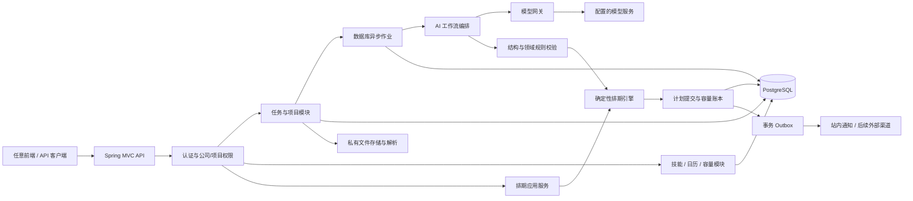
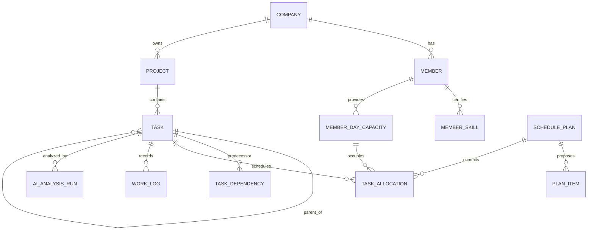
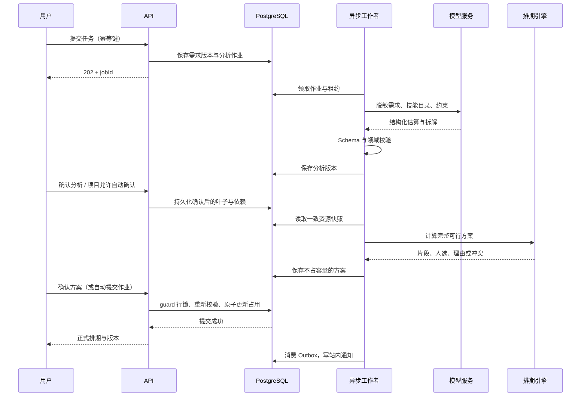

# AI Agent 项目排期管理系统 TRD

| 项目 | 内容 |
| --- | --- |
| 文档版本 | v1.0，后端技术方案与研发拆解基线 |
| 编写日期 | 2026-09-29 |
| 需求文档 | [PRD](./prd.md) |
| 强制技术栈 | Spring Boot 3、Java 21 |
| 架构选择 | 模块化单体、PostgreSQL、数据库异步作业、模型网关 |
| 前端边界 | Vue 3 + TypeScript + Vite；会话/CSRF，同源代理，hash 路由；详见 [前端实现](docs/frontend.md) |

> 本次明确要求的 Java 21 优先于原通用 JDK 8 约定。本文是待实现的技术设计，不代表已经部署或通过测试。文中 SQL、JSON 与伪代码用于明确实现契约，完整建表迁移和接口代码在开发阶段生成。

## 1. 技术目标与设计取舍

1. **硬约束可靠**：所有正式分配都满足技能、权限、日历、依赖和每日容量约束，人工操作不例外。
2. **模型输出可控**：LLM 生成结构化建议；确定性代码验证、排期并持久化。模型没有直接写数据库或给人派单的权限。
3. **适合小团队维护**：首发一个应用、一套主数据库和一个文件存储，避免为低流量业务引入微服务、分布式锁与多个消息中间件。
4. **变更可追溯**：需求、估算、拆解、排期和人工修改保留版本、来源和原因。
5. **可退化运行**：模型不可用时，任务录入、人工估算、规则排期和现有计划查询仍可用。

### 1.1 规模与性能预算

| 项目 | 首发设计基线 |
| --- | --- |
| 单公司成员 | ≤100，首批试点 10～30 |
| 单公司任务量 | 20,000 历史任务、2,000 活跃叶子任务 |
| 单次模拟 | ≤50 叶子任务、≤100 候选成员、默认 60 个日历日 |
| 单棵拆解树 | ≤30 叶子，深度 ≤3 |
| 普通查询 | P95≤500ms，压测混合负载 20 请求/秒 |
| 规则模拟 | P95≤3s，不含 LLM/附件解析 |
| 提交事务 | P95≤1s，事务内不调用模型或对象存储 |
| 模型分析 | 标准文本任务目标 P95≤60s；独立超时和预算限制 |
| 日期搜索 | 默认 60 日、最大 180 日；超限显式失败 |

以上为待压测验证的目标。公司内计划写事务有意串行化，适合首发规模；按公司并行，查询与模拟不持有该锁。后续只有在锁等待成为实测瓶颈时才细化锁粒度。

## 2. 技术选型

| 层次 | 选择 | 说明 |
| --- | --- | --- |
| JDK | Java 21 LTS | 开发、CI、生产统一；Maven `release=21` |
| 应用框架 | Spring Boot 3.5.x | 采用组织认可的 3.x 补丁，开工时核验安全与维护策略，不自动切换到 4.x |
| Web | Spring MVC、Bean Validation | REST JSON，异步长任务独立处理 |
| 安全 | Spring Security、服务端会话 | 初期账号登录；企业 SSO 后续接入 |
| 数据访问 | Spring JDBC / NamedParameterJdbcTemplate | 对容量条件更新和锁顺序保持显式控制 |
| 数据库 | PostgreSQL 17 | 关系约束、JSONB、事务、行锁、数据库作业队列 |
| 数据迁移 | Flyway | 迁移脚本纳入版本控制，生产禁止自动建表 |
| 模型调用 | 自定义 `AiModelGateway` + Spring `RestClient` | 屏蔽供应商；按需接 Spring AI，不把框架绑定到核心领域 |
| 文件存储 | S3 兼容对象存储 | 开发环境可本地目录适配，生产私有桶 |
| 异步执行 | PostgreSQL 作业表 + 受限线程池 | 可多实例领取；不依赖内存任务作为可靠来源 |
| 缓存 | 首发可不部署 Redis | 有需要用于只读缓存/限流，不作为容量真相来源 |
| 接口文档 | OpenAPI 3 + 兼容 Boot 3 的 springdoc | 具体依赖版本通过 BOM 和集成测试固定 |
| 可观测 | Actuator、Micrometer、结构化日志 | 可对接 Prometheus/Grafana，提供 readiness/liveness |
| 测试 | JUnit 5、Testcontainers PostgreSQL | 并发约束必须在真实 PostgreSQL 语义下验证 |
| 部署 | OCI 容器；试点 Compose，生产可两实例 | 不要求 Kubernetes；文件不能只存在单实例磁盘 |

Spring Boot 3.5 官方系统要求覆盖 Java 21，技术组合满足本需求；最终补丁和商业/社区维护期限需在上线时重新核验。[官方系统要求](https://docs.spring.io/spring-boot/3.5/system-requirements.html)

不默认使用向量库：首发按公司、任务类型、技能、关键词检索少量历史案例即可。没有历史数据时直接标记冷启动，避免为“AI”引入不必要的基础设施。

## 3. 总体架构



### 3.1 模块划分与依赖

```text
com.company.scheduler
  identity       用户、公司成员、会话、角色与权限
  project        项目、项目成员、派单策略
  task           任务、版本、依赖、验收、工时
  resource       技能目录、认证技能、工作日历、容量桶
  planning       快照、候选筛选、模拟、方案提交、重排
  ai             工作流、模型适配、提示模板、输出校验
  attachment     上传、扫描、文本提取、访问鉴权
  conflict       冲突归因、去重、解决条件
  notification   站内消息、模板、投递回执
  audit          审计事件与查询
  job            可靠任务、租约、重试、Outbox 分发
  shared         时钟、标识、错误码、公司上下文
```

领域模块通过应用服务和类型明确的领域事件协作，禁止跨模块绕过应用服务直接修改容量。`planning` 不依赖具体模型供应商；`ai` 不能直接调用容量 Repository。排期计算使用不可变 DTO，便于复现和离线测试。

## 4. 时间、工时和容量模型

### 4.1 类型约定

- 实际时间戳：Java `Instant` / PostgreSQL `timestamptz`，按 UTC 保存。
- 排期工作日期：Java `LocalDate` / PostgreSQL `date`，按公司 `ZoneId` 解释。
- 所有计划与容量：整数分钟 `int`，以 30 分钟为步长；不用 `double` 存工时。
- 实际工时：整数分钟，可不为 30 的倍数，用于如实记录。
- 分数/系数：`BigDecimal`，只在最终转分钟时统一舍入。
- ID：UUID；公司内对外任务编号另设唯一序列。列表按稳定游标排序。
- 周起始：周一；日期 API 用 ISO `YYYY-MM-DD`，禁止客户端传本地模糊日期。

### 4.2 容量计算

令 S 为标准工时，D 为个人每日任务上限，L 为请假时长，M 为额外不可用时长：

```text
工作日：C = max(0, floor30(min(D, max(0, S - L)) - M))
休息日：C = 0
U = sum(allocation.minutes where allocation.occupancy_state in [RESERVED, RETAINED])
R = C - U
硬不变量：0 <= U <= C，且 C、U 均为 30 的倍数
```

例：S=480、D=360、L=240、M=60，则 C=180 分钟。M 不包括已经由 480→360 预留的常规会议时间，避免重复扣减。单日特殊容量覆盖仍须在当天可用工作时长以内。休息日必须先被授权改为工作日，不能直接塞入容量。

`member_day_capacity` 是容量计数与版本的唯一入口。`task_allocation` 是占用明细。两者在同一事务内修改，使用延迟一致性约束和定期对账保证 `计数=明细之和`。

### 4.3 工时、日期与历史保留

- `baseline_minutes`：首次确认的计划总投入，用于复盘，范围变更生成新基线版本。
- `estimated_minutes`：当前完整计划的确认投入，首排须等于全部当前 RESERVED 片段之和。
- `remaining_minutes`：由成员/负责人确认的待完成投入，不从实际工时直接推算。
- `actual_minutes`：实际工时流水聚合，不写入 U，不和计划重复扣容量。
- 对未开始任务，全量计划可重排，新的片段总和必须等于确认计划工时。
- 对进行中任务，历史及当日已开始片段冻结；重排从次日或更晚开始，用成员确认的“当日结束后剩余工时”生成未来片段。首发不自动计算当天几点以后还能干多少工作。
- 完成/取消时，过去及今日已开始片段转 RETAINED，未来 RESERVED 片段释放；今日未开始片段可释放。
- 日期结束后，过去 RESERVED 转 RETAINED，保留原计划占用痕迹；未执行任务不能把昨日未用容量挪到今日。未开始且错过计划日期的任务置 STALE 并重排；进行中任务根据剩余工时确认更新未来计划。
- RETAINED 表示不可重新出售的历史/当日计划占用，不宣称等于实际工作时长。实际工时独立统计。

## 5. 领域对象与状态机

### 5.1 核心关系



### 5.2 业务状态

`DRAFT → SUBMITTED → NEEDS_INFO / READY → IN_PROGRESS → IN_REVIEW → DONE`。

- NEEDS_INFO 补全后进入 SUBMITTED，重新分析。
- READY / IN_PROGRESS 可进入 BLOCKED；保存 `blocked_from_status`，解除后回到该状态，且重新检查排期有效性。
- IN_REVIEW 退回 IN_PROGRESS，必须确认剩余工时并检查未来计划。
- 非终态可由有权限者取消；DONE 重开必须提供原因、版本和新剩余工时，进入 READY，保留旧完成事件。
- 取消前置任务时，尚未完成的后继进入 BLOCKED，并触发计划失效处理。
- 父节点为汇总节点，不允许直接开始、记录执行工时或占容量；完成由所有必需叶子 DONE 推导。

排期状态独立：`UNSCHEDULED → PLANNED → STALE → PLANNED`；完成/取消为 CLOSED。无解时保留 UNSCHEDULED 或 STALE，并关联冲突。模拟方案不改变任务排期状态。

### 5.3 方案状态

`GENERATING → READY / INFEASIBLE / FAILED`；READY 可 `COMMITTED / EXPIRED / REJECTED`。

- READY 有完整可行排期，默认 15 分钟有效。
- INFEASIBLE 可保留局部模拟结果供解释，但不能提交。
- COMMITTED 不可直接回滚；“撤回”是基于当前状态产生补偿方案。
- 任一输入版本变化使方案不可提交，即使尚未到过期时间。
- 自动提交作业和人工确认使用同一个 commit 应用服务。

## 6. 数据设计

### 6.1 通用规范

业务表带 `company_id`、`created_at`、`updated_at`；可变实体带 `version bigint`。用户来自认证会话，`company_id` 从已验证的请求上下文取得，不信任 JSON 中的同名字段。涉及跨表公司归属的外键使用 `(company_id,id)`，禁止只用全局 ID 做归属校验。

任务等长期对象使用归档标记，不硬删已排期或已审计对象。任务标题等用户输入不作为日志标签。关键事件表追加写，应用普通账号无权修改审计历史。

### 6.2 表清单

| 表 | 核心字段 / 约束 | 用途 |
| --- | --- | --- |
| company | id、name、timezone、settings_json | 公司设置 |
| app_user | id、login、password_hash、status | 用户身份，与公司成员分离 |
| company_member | company_id、user_id、role、status、accept_new_assignments、accept_auto_assign、standard_minutes、daily_limit_minutes、version | 人员与默认容量；同公司用户唯一 |
| project / project_member | company_id、id、strategy_json；member_id、resource_permission | 项目访问及可派资源 |
| skill / member_skill | code、name；member_id、level、certified_by、certified_at | 目录和认证技能 |
| calendar_day / member_calendar_override | work_date、workday_flag、leave_minutes、extra_unavailable_minutes、source、version | 公司工作日和成员覆盖 |
| member_day_capacity | member_id、work_date、capacity_minutes、occupied_minutes、version、calendar_version | 容量桶，成员日期唯一 |
| task | project_id、parent_id、node_type、status、schedule_status、priority、due_type、due_date、assignee_id、estimate fields、version | 当前业务快照 |
| task_revision | task_id、revision、content_json、source、actor_id | 原始输入和需求版本 |
| task_skill_requirement | task_id、skill_id、min_level、required | 必需与加分技能 |
| task_dependency | project_id、predecessor_id、successor_id、type=FS | 有向依赖，组合唯一 |
| task_allocation | task_id、member_id、work_date、minutes、occupancy_state、execution_started、plan_id | 容量占用流水/片段 |
| schedule_plan | input_snapshot_json、input_revision、algorithm_version、status、expires_at、hash、created_by | 模拟和提交记录 |
| plan_item | plan_id、task_id、member_id、work_date、minutes、operation | 新增/释放/保留操作清单，不占容量 |
| task_plan_lock | task_id、lock_owner、reason、locked_fields、version | 首发支持整任务人选/日期锁定 |
| work_log | task_id、member_id、work_date、minutes、note、idempotency_key | 实际工时，修改留 revision |
| task_remaining_estimate | task_id、effective_after_date、remaining_minutes、confirmed_by、version | 日终剩余投入确认 |
| attachment | object_key、sha256、mime、size、scan_status、parse_status、text_object_key | 私有附件与解析结果 |
| import_batch / import_row | source_hash、client_key、row_number、validation_json、status | CSV 幂等与错误定位 |
| ai_analysis_run | input_hash、model、prompt_version、schema_version、status、usage、quality_json | AI 运行记录与成本 |
| async_job | type、payload_ref、status、lease_owner、lease_until、lease_generation、attempts、next_run_at | 持久作业队列 |
| planning_guard | company_id、revision | 公司排期写锁与输入版本 |
| conflict | root_event_id、fingerprint、type、severity、status、details_json | 冲突聚合与生命周期 |
| outbox_event / processed_event | event_id、aggregate_id、payload、published_at；consumer_name | 至少一次事件与幂等消费 |
| notification / delivery_attempt | event_id、recipient、channel、status | 站内通知和外部投递 |
| audit_event | actor、action、entity、before_after_json、reason、request_id | 操作审计 |
| api_idempotency | company_id、actor_id、route、key、request_hash、status、response_ref | 写接口重复请求保护 |
| spring_session 等框架表 | 会话、过期、属性 | JDBC 会话共享与撤销 |

### 6.3 容量与分配核心 DDL 示例

以下节选假定 `company_member`、`task`、`schedule_plan` 已定义 `(company_id,id)` 唯一键；完整迁移需补齐所有表和外键。分钟字段都使用非空约束，不能让 NULL 绕过 CHECK。

```sql
CREATE TABLE planning_guard (
  company_id uuid PRIMARY KEY,
  revision bigint NOT NULL DEFAULT 0
);

CREATE TABLE member_day_capacity (
  company_id uuid NOT NULL,
  member_id uuid NOT NULL,
  work_date date NOT NULL,
  capacity_minutes integer NOT NULL,
  occupied_minutes integer NOT NULL DEFAULT 0,
  calendar_version bigint NOT NULL,
  version bigint NOT NULL DEFAULT 0,
  PRIMARY KEY (company_id, member_id, work_date),
  FOREIGN KEY (company_id, member_id)
    REFERENCES company_member(company_id, id),
  CHECK (capacity_minutes >= 0 AND capacity_minutes % 30 = 0),
  CHECK (occupied_minutes >= 0 AND occupied_minutes % 30 = 0),
  CHECK (occupied_minutes <= capacity_minutes)
);

CREATE TABLE task_allocation (
  id uuid PRIMARY KEY,
  company_id uuid NOT NULL,
  task_id uuid NOT NULL,
  member_id uuid NOT NULL,
  work_date date NOT NULL,
  minutes integer NOT NULL CHECK (minutes > 0 AND minutes % 30 = 0),
  occupancy_state varchar(16) NOT NULL
    CHECK (occupancy_state IN ('RESERVED', 'RETAINED', 'RELEASED')),
  execution_started boolean NOT NULL DEFAULT false,
  plan_id uuid NOT NULL,
  created_at timestamptz NOT NULL DEFAULT now(),
  FOREIGN KEY (company_id, task_id) REFERENCES task(company_id, id),
  FOREIGN KEY (company_id, plan_id) REFERENCES schedule_plan(company_id, id),
  FOREIGN KEY (company_id, member_id, work_date)
    REFERENCES member_day_capacity(company_id, member_id, work_date)
);

CREATE UNIQUE INDEX uq_task_active_day
  ON task_allocation(company_id, task_id, work_date)
  WHERE occupancy_state = 'RESERVED';

CREATE INDEX idx_member_active_allocations
  ON task_allocation(company_id, member_id, work_date)
  WHERE occupancy_state IN ('RESERVED', 'RETAINED');

CREATE TABLE task_dependency (
  company_id uuid NOT NULL,
  project_id uuid NOT NULL,
  predecessor_id uuid NOT NULL,
  successor_id uuid NOT NULL,
  dependency_type varchar(4) NOT NULL DEFAULT 'FS'
    CHECK (dependency_type = 'FS'),
  PRIMARY KEY (company_id, predecessor_id, successor_id),
  CHECK (predecessor_id <> successor_id),
  FOREIGN KEY (company_id, project_id, predecessor_id)
    REFERENCES task(company_id, project_id, id),
  FOREIGN KEY (company_id, project_id, successor_id)
    REFERENCES task(company_id, project_id, id)
);
```

`task` 须额外声明 `(company_id,project_id,id)` 唯一键。外键保证同公司/同项目，环检测和叶子约束由应用服务在公司写锁内执行。父子关系同样使用公司/项目复合外键，父链深度校验与依赖校验分开进行。

### 6.4 必须补充的数据库防线

- 为容量桶与分配表建立 `DEFERRABLE INITIALLY DEFERRED` 约束触发器：提交前对受影响的新旧桶验证 `occupied_minutes = SUM(RESERVED + RETAINED)`，不等则抛错回滚。删除、改日期、改人员也必须覆盖旧桶。
- 触发器不替代事务锁；所有应用写入仍遵循公司 guard。普通业务账号不开放任意 SQL 执行入口。
- 对同一任务的当前 RESERVED 片段检查负责人一致，且只能指向 LEAF 节点；历史 RETAINED 可保留旧负责人。
- API 幂等键唯一：`(company_id, actor_id, route, key)`；同 key 不同请求 hash 返回 409。
- 通知唯一：`(company_id,event_id,recipient_id,channel)`；Outbox 消费唯一：`(consumer_name,event_id)`。
- 当前任务列表索引：`(company_id,project_id,status,updated_at,id)`；个人列表：`(company_id,assignee_id,schedule_status)`；依赖正反向索引均建立。
- 作业领取索引：`(status,next_run_at)`；历史 JSONB 不默认建立大范围 GIN 索引，按真实查询添加。

## 7. AI Agent 工作流

这里的 Agent 是受限工作流编排器，首发不采用无限反思循环，也不需要多个自治 Agent 互相协商。

### 7.1 工作流步骤

| 步骤 | 输入 | 输出 | 失败处理 |
| --- | --- | --- | --- |
| 1. 资料提取 | 表单、已扫描附件 | 标准化正文、来源片段 | 文件解析失败可人工补全文本 |
| 2. 信息检查 | 正文、项目模板 | 缺失字段、关键问题 | NEEDS_INFO，最多 5 个关键问题 |
| 3. 分类估算 | 类型目录、技能目录、历史案例 | 工时、技能、假设 | 结构修复最多 1 次 |
| 4. 大任务拆解 | 需求、阈值、交付模板 | 叶子列表、依赖边 | 超限或环依赖转人工 |
| 5. 领域校验 | 结构化输出 | 合法领域 DTO、质量分 | 不能用低分结果自动派单 |
| 6. 规则模拟 | 领域 DTO、授权资源快照 | 人选和逐日片段 | 无解输出冲突及建议 |
| 7. 解释生成 | 已验证计划和规则命中 | 面向人的简要解释 | 模板解释兜底，不影响计划合法性 |
| 8. 策略判定 | 准入条件 | 人工待审 / 自动提交作业 | 自动提交仍走同一事务服务 |

初次调用可合并分类、估算、拆解以控制成本。质量校验与容量模拟始终独立于模型调用。对单任务输入快照与参数相同的重试复用运行结果，不默认重复付费调用。

### 7.2 模型网关接口

```java
public interface AiModelGateway {
    AnalysisResult analyze(AnalysisRequest request);
}

public record AnalysisRequest(
    UUID runId,
    String schemaVersion,
    String taskText,
    List<SkillDefinition> allowedSkills,
    List<HistoricalExample> examples,
    AnalysisLimits limits
) {}
```

供应商适配负责鉴权、请求构造、超时、限流、token usage 提取和结构化输出功能差异。缺少原生 JSON Schema 支持时仍可请求 JSON，但必须执行同样的服务端验证。供应商密钥只在服务端秘密管理中保存。

### 7.3 输出契约示例

```json
{
  "schemaVersion": "1.0",
  "taskType": "BACKEND_DEVELOPMENT",
  "summary": "实现登录接口并交付接口测试结果",
  "requiresDecomposition": false,
  "estimate": {
    "optimisticMinutes": 180,
    "likelyMinutes": 240,
    "pessimisticMinutes": 360,
    "basis": "采用项目已有鉴权组件；不包含第三方 SSO"
  },
  "requiredSkills": [{"code": "JAVA", "minLevel": 3}],
  "acceptanceCriteria": ["成功登录返回有效会话", "错误密码拒绝登录"],
  "assumptions": [{"text": "项目已有鉴权组件", "confirmed": false}],
  "missingInformation": ["是否需要对接企业 SSO"],
  "confidence": 0.76,
  "subtasks": [],
  "dependencies": []
}
```

拆解任务使用临时 `clientKey`（如 S1、S2）和相同叶子字段，依赖用 `{ "from":"S1", "to":"S2", "type":"FS" }`。持久化时由服务端生成 UUID 并建立映射。模型不能自造现有成员 ID、数据库主键或伪造 `confirmed=true`；确认字段最终来自用户记录。

### 7.4 输出与安全校验

1. JSON Schema 严格限制字段、枚举、数量和长度；拒绝未知字段、负数、无穷值、超大估算。
2. `0 < optimistic ≤ likely ≤ pessimistic`；单叶子通常 ≤16h，超过时必须有人工批准的不可拆原因。
3. 技能代码必须命中公司目录；模型发现新技能只能提议创建，不能直接改变目录。
4. 每个叶子有交付物/验收标准；父子关系、依赖无环、深度/数量不超限。
5. 禁止模型提升权限、改变截止类型、增加容量、为自己确认假设。
6. 附件和历史案例放入明确标记的数据区，不能升级为 system/tool 指令；模型无数据库、shell、文件任意读取工具。
7. 输出文本按不可信内容渲染，转义 HTML，不直接执行模型生成链接、脚本或 SQL。
8. 发送模型前使用伪名成员标识，剔除电话、邮箱、客户凭据等无关数据；模型不需要成员完整通讯录。

### 7.5 估算与质量分

```text
base = (optimistic + 4 * likely + pessimistic) / 6
candidateEstimate = ceil30(base * calibrationFactor * (1 + bufferRatio))
```

首发 `calibrationFactor=1`，默认 `bufferRatio=0.20`。上例基础估算为 250 分钟，含缓冲为 300 分钟，即 5h。人工提交 `estimateSource=MANUAL_FINAL` 时直接对最终工时取整，不重复加缓冲。

质量分为工程启发式分数，不是概率：`Q=0.35*完整性+0.25*案例相似证据+0.20*估算区间稳定性+0.20*模型自报分`，各项 [0,1]。冷启动证据项置 0.5 并标注；缺少验收标准、未确认关键假设、输出非法属于独立阻断条件，不能靠总分抵消。自动派单还要求 `pessimistic/optimistic≤2.5`。

P1 校准需同成员同类已完成任务 ≥20 个、排除明确范围变更样本、使用稳健统计，将因子限制在 [0.7,1.5] 并支持人工关闭。首发不实现，也不凭 Q 计算人的绩效。

### 7.6 调用预算、重试与降级

- 单任务标准化文本最多 20,000 字符，超限分段摘要并保留来源；摘要步骤计入总预算。
- 默认单次模型网络超时 45s，整个分析作业最迟 180s 结束；标准任务的 60s 是体验目标，不是重试最坏时长。
- 单运行最多 4 次外部调用：原始分析、最多一次结构修复以及预算内的短暂故障重试；超限停止。附件分段超预算时转人工缩小范围。
- 429/短暂 5xx 网络错误采用带抖动退避；非法业务结果不盲目网络重试，权限/凭据错误直接失败并通知管理员。
- 记录实际 token 数、供应商 usage 和模型版本；设置公司每日调用/token 上限，金额按配置单价估算，不硬编码市场价格。
- 达到预算、超时或模型不可用时返回可解释错误；支持人工估算后调用相同排期接口。

## 8. 确定性排期算法

### 8.1 输入、输出与算法边界

输入：任务和依赖 DAG、已确认技能需求、成员认证技能、公司/项目资源授权、日历容量快照、既有分配、锁定、优先级和截止规则。

输出：每个叶子的唯一负责人、逐日分配分钟、开始/完成日期、评分分项、未选理由、受影响任务和冲突。算法是有界启发式可行性搜索，不宣称证明全局无解。若搜索未发现方案，错误注明“当前规则/搜索范围内未找到”，区别于某个硬条件确实不满足。

### 8.2 任务排序

1. 已开始/锁定计划作为不可移动占用输入，不加入普通自动改派队列。
2. 校验 DAG，使用 Kahn 拓扑排序；若未能处理所有节点，返回具体环路径。
3. 在当前入度为 0 的可调度任务中，依次按紧急优先级、硬截止最早、合格候选人数最少、后继累计工作量最大、创建时间、taskId 排序。业务优先级为 P0 紧急、P1 高、P2 普通（默认）、P3 低。
4. 前置有未排定工作时，后置不提前计算可提交片段。

### 8.3 成员过滤与可行日期

硬过滤：同公司、在职、项目资源权限、必需认证技能、接受自动派单、硬指定符合、可工作日期、有正容量。进行中任务自动保持原负责人；人工改负责人需要交接工时。

其中 `accept_new_assignments=false` 阻止所有新增分配；`accept_auto_assign=false` 只排除自动候选，人工明确选择该成员时可继续校验其他硬约束。两种开关均参与输入版本管理。

```text
earliestDate = max(
  用户允许开始日,
  公司本地今天,
  所有前置预计完成日 + 1 日
)
```

从 earliestDate 向后扫描候选成员日历，跳过 C=0 或 R=0 日期，将 `min(剩余任务分钟,R)` 放入当天。保留同一负责人直到任务工时全部分配完毕。超过硬截止或搜索边界则该候选不可行。期望截止允许生成晚交方案，但只能人工确认。

硬截止沿父链向叶子继承，取祖先与叶子所有硬截止的最早日期；父任务完成日期为必需叶子完成日的最大值。已 DONE 前置以实际验收完成日在公司时区内的日期作为释放依据，其余前置使用有效计划完成日；不存在有效日期则后置不可提交。后继能否实际开始仍需独立检查前置 DONE。

候选人之间存在不同工时因子时，以该成员的完整估算计算，不能先按 A 的工时选 B。首发因子统一为 1，保留此扩展接口。

### 8.4 同日改派与评分

先形成所有完整可行候选方案，再按以下层级选取：

1. 若偏好成员在 earliestDate 满额，优先比较其他在该日期可开始的完整可行候选方案；硬指定则禁止换人。
2. 若没有同日可行方案，比较后续日期方案；不得把无技能成员当作候选。
3. 同层级评分：`Score=0.35*技能匹配+0.30*完成速度+0.20*负载均衡+0.10*连续性+0.05*偏好`，全部归一化为 [0,1]。
4. 技能匹配考虑加分技能和认证等级；完成速度按候选完成日在搜索范围内的位置归一化；负载均衡基于未来 10 个可工作日占用率；连续性反映同模块参与关系，偏好来自显式设置。
5. 同分按完成日期、开始日期、memberId 稳定排序。记录各项分数，不允许技能匹配高分越过硬过滤。

### 8.5 有界搜索与完整提交

单纯贪心可能让通用任务先占用唯一专家，导致后续专门任务无位置。首发使用有界 beam search：每步保留最多 10 个部分方案，每任务尝试排名前 3 个候选，再执行约束校验；总搜索时间默认 2.5s，给序列化和读数据预留时间。

- 优先约束更稀缺的任务作为拓扑同层的附加排序因素。
- 若超时但已发现完整可行方案，选择最好的一份；没有完整方案则返回 `SEARCH_LIMIT_REACHED`，不声称硬约束必然无解。
- 所有候选使用隔离的内存容量副本，试探失败必须回退增量。
- 同一拆解树首排必须全树可行、原子提交；不能把 beam 中半成品提交。
- 独立任务的批量处理可拆成多个根任务计划，各自原子提交；API 明确返回各根结果，不宣称整个批次原子。
- 依赖同一根之外已有任务时，将其已确认完成日期和版本纳入快照；受其变化影响的后继统一失效。

### 8.6 算法伪代码

```text
simulate(snapshot, roots):
  validatePermissionsAndInput(snapshot)
  graph = validateDagAndExpandRoots(roots)
  fixed = snapshot.existingReservationsAndLocks
  states = [newState(fixed)]
  while some task remains:
    nextStates = []
    for state in states:
      task = chooseReadyTask(state, graph)
      candidates = filterEligibleMembers(task, snapshot)
      options = buildFullCrossDayOptions(task, candidates, state.capacity)
      for option in topOptions(options, 3):
        nextStates += copyAndApply(state, option)
    states = keepBestFeasiblePartialStates(nextStates, 10)
    enforceTimeBudget()
  result = bestCompleteState(states)
  validateAllInvariants(result)
  return plan(result, inputRevision, taskVersions, reasons)
```

实际实现必须保留已完成 states 并处理空候选/超时，不能照伪代码把无结果当空计划提交。日志只记录指标和原因代码，不暴露附件正文。

## 9. 并发、容量原子性与幂等

### 9.1 快照一致性

生成方案时用短 `REPEATABLE READ` 只读事务一次获取同一公司 planning_guard.revision、任务、成员、依赖、日历和容量，然后结束事务再运行 AI/搜索。模型分析可能先发生，但模拟前必须重新读取最新已确认需求和资源快照。

凡是影响可行性的写入均锁定 guard 并递增 revision：任务工时/状态/优先级/截止、技能认证、成员在职与资源范围、依赖、日历、容量、任务开始/完成/取消、锁定以及排期。评论、已读通知和纯事实工时补录不影响计划时可以不递增；更新剩余工时则必须递增。

采用公司级 revision 会使无关计划变更也令草案过期，这是首发为正确性选择的保守策略。后续可以改为受影响实体版本向量。

### 9.2 锁顺序

所有计划相关写事务统一顺序：

1. 公司 `planning_guard` 行 `SELECT ... FOR UPDATE`。
2. 幂等记录、目标方案与受影响任务，按 ID 顺序。
3. 成员与依赖相关数据的必要校验。
4. 容量桶按 `(member_id,work_date)` 排序加行锁。
5. 分配明细、任务更新、审计、Outbox。

禁止某入口先锁容量再锁 guard。公司 guard 的创建与公司初始化同事务完成，不在业务竞争时临时缺省。容量桶预生成未来 180 日；临时缺桶时在 guard 内按权威日历创建，不能用任意请求提供的容量补行。

PostgreSQL 行锁使其他冲突更新等待当前事务结束；这里用它保护短提交事务，而不是在模型请求期间持锁。[PostgreSQL 17 显式锁文档](https://www.postgresql.org/docs/17/explicit-locking.html)

### 9.3 提交事务流程

```text
commit(planId, expectedPlanVersion, idempotencyKey):
  authenticate + authorize
  begin transaction (READ COMMITTED)
  lock company planning_guard
  if successful idempotency record exists:
    verify identical request hash
    return saved result
  load plan FOR UPDATE
  verify READY, not expired, matching plan version
  verify plan.inputRevision == guard.revision
  reload affected task states, skills, dependencies, calendars and locks
  validate exact proposed changes and approval scope
  lock all affected day buckets in stable order
  compute per-bucket net delta (new occupancy - releasable old occupancy)
  guardedUpdateAllBuckets(delta)  // any failure rolls back all
  write RELEASED old rows + RESERVED new rows; preserve RETAINED rows
  update task assignees, dates, statuses and versions
  validate full plan coverage, dependencies and deadline constraints
  mark plan COMMITTED; increment guard.revision
  insert audit + outbox + successful idempotency response
  commit  // deferred accounting constraint validates detail sums
```

容量更新示例，对每个桶执行，零行更新即失败：

```sql
UPDATE member_day_capacity
SET occupied_minutes = occupied_minutes + :delta,
    version = version + 1
WHERE company_id = :companyId
  AND member_id = :memberId
  AND work_date = :workDate
  AND occupied_minutes + :delta >= 0
  AND occupied_minutes + :delta <= capacity_minutes;
```

改派使用净变化，先计算整份替换后的账本，不在两个独立事务中“先释放再抢占”。保留占用不可计入可释放量。若提交失败，旧人选、旧占用、旧状态和通知均不改变。

### 9.4 重试与冲突返回

- 锁等待超时/死锁：事务完整回滚，服务器最多 3 次带抖动重试；不得只重试一条 SQL。
- 版本变化/容量被抢：人工确认返回 409，展示差异并重新模拟，不自动确认另一份不同方案。
- 自动派单可在项目策略授权内重新模拟，最多 3 轮，每轮新建方案版本；仍失败则待排。
- 同 key 同内容在事务成功但响应丢失时返回第一次成功结果；同 key 不同内容返回 `IDEMPOTENCY_KEY_REUSED`。
- 幂等记录默认保存 7 天；方案提交状态和唯一业务事件永久避免同一 plan 二次提交，即使幂等记录已经清理。
- Redis 锁、客户端禁用按钮和先查询后插入不能替代数据库不变量。

## 10. 动态重排与冲突处理

### 10.1 触发事件

`TaskSubmitted`、`EstimateChanged`、`TaskDelayed`、`TaskCompleted`、`MemberUnavailable`、`CalendarChanged`、`CapacityChanged`、`DependencyChanged`、`TaskCanceled`、`PriorityChanged`。

每个事件有唯一 ID、公司、聚合版本、发生时间、原因和受影响实体。事件消费按当前版本检查，过时事件可以合并或跳过，但不能撤销较新结果。

### 10.2 影响范围与处理

1. 找出直接影响任务，沿依赖边遍历所有未完成后继，形成影响闭包。
2. 只自动移动未开始、未锁定任务；进行中和锁定任务形成需要人工决策的边界。
3. 已提交、只是“可能延期”的计划先保留容量并置 STALE，不显示为已解决；禁止以失效计划新开工。
4. 未来容量下调需要立即满足新容量时，确认事务中释放可移动任务片段并将其移入待排，或提交替代完整方案；不能先把容量降成负余量，再等待后台修复。
5. 若减少到低于不可释放的历史/今日已开始占用，返回 `CAPACITY_BELOW_RETAINED`。突发不可用先关闭新任务接收，保留历史，未来日期再执行容量调整。
6. 锁定任务不得自动解锁。冲突预览需明确解锁项，只有具备权限且提交相同版本确认才可执行。
7. 重排改变已承诺日期或影响其他项目时，必须由对受影响范围有权限的人批准；项目负责人不能单方挤占其他项目资源。
8. 普通变更按任务 30 分钟防抖，每日最多自动改派 2 次；失效风险即时标记，不能因防抖隐藏冲突。

### 10.3 冲突存储与关闭

冲突 fingerprint 由公司、类型、根因、任务/成员/日期维度组成。相同根因更新影响集合，不重复建上百条后继告警。解决请求触发条件复核，只有新计划有效、信息补齐或需求正式取消后才能 RESOLVED。人工 ACKNOWLEDGED 只代表已知晓，不代表已解决。

### 10.4 补偿与历史恢复

恢复旧计划是新模拟，必须检验当前权限、技能、容量和依赖。已完成任务和实际工时不可通过恢复排期抹除。通知发送失败只重试通知，不回滚已经成功的计划；附件解析失败也不影响既有任务计划。

## 11. API 契约

### 11.1 通用规则

- 路径前缀 `/api/v1`，请求/响应 JSON，UTF-8。
- 通过当前会话和公司选择头 `X-Company-Id` 确定上下文；头只用于选择，后端必须校验成员关系。
- 写接口携带 `Idempotency-Key`；更新实体用 `If-Match: "<version>"`；创建无需 If-Match。
- 分页 `cursor`、`limit`（默认 20、最大 100）；排序字段白名单，游标绑定公司、过滤条件和稳定排序键。
- 成功对象含 `data`、`requestId`；集合额外含 `nextCursor`；异步调用 HTTP 202 返回 jobId 和状态查询地址。
- 时间戳 RFC 3339；工时 API 使用 minutes，不接收“1.5 天”等模糊字符串。
- 错误含机器码、中文信息、字段错误和可恢复信息；不把堆栈或模型原始响应直接返回用户。

### 11.2 接口清单

| 方法与路径 | 用途 | 关键校验/行为 |
| --- | --- | --- |
| POST `/auth/login`；POST `/auth/logout` | 登录/注销 | 限流、会话轮换、CSRF 防护 |
| GET `/me/companies` | 可访问公司 | 不返回其他公司信息 |
| GET/POST `/projects` | 项目列表/创建 | 角色权限 |
| PUT `/projects/{id}/policy` | 自动派单策略 | If-Match，审计、影响版本 |
| GET/POST `/members` | 成员列表/添加 | 管理权限 |
| PUT `/members/{id}/skills` | 技能认证 | 认证人权限，影响方案失效 |
| PUT `/members/{id}/capacity-policy` | 默认容量 | 不直接破坏已排日期，需变更预览流程 |
| POST `/calendar-changes/preview` | 日历/请假影响模拟 | 返回不可移动占用和替代方案 |
| POST `/calendar-changes/{id}/commit` | 提交日历与排期变更 | 同一容量事务，无非法中间状态 |
| POST `/attachments` | 上传文件 | multipart，类型/体积校验，202 扫描解析 |
| GET `/attachments/{id}` | 附件状态 | 上传者或关联任务权限 |
| GET `/attachments/{id}/download` | 下载 | 鉴权后代理或短时签名 URL |
| POST `/task-imports` | CSV 校验预览 | ≤200 行，client_key 唯一 |
| POST `/task-imports/{id}/confirm` | 确认导入 | 全批合法、幂等原子入库 |
| POST `/tasks` | 新建草稿 | 明确 projectId、标题、正文/附件 |
| GET `/tasks`；GET `/tasks/{id}` | 列表/详情 | 项目授权、过滤和脱敏 |
| PATCH `/tasks/{id}` | 修改需求 | If-Match，已排任务走变更版本 |
| POST `/tasks/{id}/submit` | 提交分析 | 创建异步运行，返回 202 |
| POST `/tasks/{id}/analyses` | 重新分析 | 新版本，不覆盖执行计划 |
| POST `/tasks/{id}/analysis-confirmations` | 确认估算/拆解 | 验证 schema、工时、依赖和人工确认范围 |
| PUT `/tasks/{id}/dependencies` | 更新前置 | guard 内无环/同项目校验 |
| POST `/schedule-plans/simulations` | 单/多根任务模拟 | 202，最多 50 叶子 |
| GET `/schedule-plans/{id}` | 模拟方案及差异 | 包含 inputRevision、到期、理由、冲突 |
| POST `/schedule-plans/{id}/commit` | 原子提交 | 幂等、版本、实时硬约束 |
| POST/DELETE `/tasks/{id}/plan-lock` | 锁定/解锁 | 权限、原因、If-Match；DELETE 为显式解锁 |
| GET `/schedules/members` | 成员排期 | memberIds、from、to，范围≤92 日 |
| GET `/members/{id}/capacity` | 容量明细 | 返回 C/U/R 与来源，不越权暴露任务 |
| POST `/tasks/{id}/transitions` | 开始、阻塞、送验、完成、取消、重开 | 明确 action、状态合法性及容量处理 |
| POST `/tasks/{id}/work-logs` | 记录实际工时 | 本人/代填权限，幂等 |
| PUT `/tasks/{id}/remaining-estimate` | 确认剩余工时 | 指明 effectiveAfterDate，触发未来重排 |
| GET `/conflicts` | 冲突列表 | 项目/成员过滤和权限 |
| POST `/conflicts/{id}/acknowledge` | 确认知晓 | 不改变硬约束或释放容量 |
| POST `/conflicts/{id}/resolve` | 复核解决 | 条件仍在则拒绝 |
| GET `/jobs/{id}` | 作业进度 | 仅可访问原业务对象者可查 |
| GET `/notifications`；POST `/notifications/{id}/read` | 站内消息 | 当前用户 |
| GET `/audit-events` | 审计查询 | 管理权限、分页、敏感字段脱敏 |

默认容量修改若影响现有桶，返回变更预览 ID，再使用统一 calendar-change commit 流程；不能简单 PUT 后直接使未来占用非法。手动拖拽生成含固定目标成员/日期约束的模拟请求，不提供绕过计划提交的分配接口。

### 11.3 创建任务请求示例

```json
{
  "projectId": "11111111-1111-4111-8111-111111111111",
  "title": "实现登录接口",
  "description": "支持账号密码登录，返回会话并记录失败原因",
  "taskType": "BACKEND_DEVELOPMENT",
  "priority": "P2",
  "dueDate": "2026-10-15",
  "dueType": "SOFT",
  "earliestStartDate": "2026-10-12",
  "estimatedMinutes": 300,
  "estimateSource": "MANUAL_FINAL",
  "preferredMemberId": null,
  "fixedAssigneeId": null,
  "attachmentIds": []
}
```

日期是否工作日以公司日历为准，示例不隐含节假日推断。草稿中的手填估算并不跳过提交和技能确认。

### 11.4 模拟与提交示例

```json
{
  "rootTaskIds": ["22222222-2222-4222-8222-222222222222"],
  "horizonDays": 60,
  "mode": "NEW_ASSIGNMENT",
  "constraints": {
    "allowMoveExistingUnstarted": false,
    "allowSoftDeadlineDelay": false
  }
}
```

```json
{
  "data": {
    "planId": "33333333-3333-4333-8333-333333333333",
    "status": "READY",
    "version": 1,
    "inputRevision": 128,
    "expiresAt": "2026-09-29T04:15:00Z",
    "items": [
      {
        "taskId": "22222222-2222-4222-8222-222222222222",
        "memberId": "44444444-4444-4444-8444-444444444444",
        "workDate": "2026-10-12",
        "minutes": 300,
        "operation": "RESERVE"
      }
    ],
    "explanations": [{"code": "SKILL_AND_CAPACITY_MATCH", "text": "满足必需技能，当日有 300 分钟余量"}],
    "conflicts": []
  },
  "requestId": "req-example"
}
```

提交请求体 `{ "expectedPlanVersion":1, "acceptedRiskCodes":[] }`，使用 `Idempotency-Key`。前端不能提交任意改过的 items；修改方案必须重新模拟。人工接受期望截止延期需列出对应风险代码，硬约束不能通过该字段接受。

### 11.5 冲突错误示例

```json
{
  "code": "PLAN_VERSION_STALE",
  "message": "生成方案后成员容量已改变，请重新模拟",
  "requestId": "req-example-2",
  "details": {
    "planInputRevision": 128,
    "currentRevision": 129,
    "retryable": true,
    "suggestedAction": "RESIMULATE"
  }
}
```

HTTP 分类：400 参数格式错误；401 未登录；403 无操作权限；404 对象不存在或对该调用者不可见；409 版本/容量/状态冲突；422 需求完整但无法形成合法方案；429 限流；503 模型/系统暂不可用。异步模拟无解时查询接口仍为 200，业务状态 INFEASIBLE；不能把整个任务查询变为 422。

主要领域码：`CAPACITY_FULL`、`CAPACITY_BELOW_RETAINED`、`NO_SKILL_MATCH`、`HARD_DEADLINE_UNREACHABLE`、`DEPENDENCY_CYCLE`、`PREDECESSOR_NOT_DONE`、`MEMBER_UNAVAILABLE`、`LOCKED_PLAN_IMPACT`、`PLAN_VERSION_STALE`、`AI_SCHEMA_INVALID`、`SEARCH_LIMIT_REACHED`、`IDEMPOTENCY_KEY_REUSED`。

## 12. 关键链路时序



AI 调用、方案计算、人工等待都发生在容量写事务之外。首次大任务拆解和关键假设始终需要人工确认；时序中的自动确认仅适用于已经满足 PRD 准入的普通任务。

## 13. 可靠作业、事件与通知

### 13.1 作业领取

- 定时扫描 `QUEUED/RETRY_WAIT` 且 `next_run_at<=now()` 的作业，用短事务 `FOR UPDATE SKIP LOCKED` 领取。
- 领取时设置 RUNNING、lease_owner、lease_until，并递增 lease_generation，提交领取事务后才执行外部调用。
- 长任务按租约周期续租；进程失联后允许回收。写结果必须以 `(jobId,lease_owner,lease_generation)` 条件更新，防止旧工作者恢复后覆盖新结果。
- 状态：QUEUED → RUNNING → SUCCEEDED / RETRY_WAIT / FAILED / CANCELED。
- 默认最多 3 个执行尝试；模型运行内部受第 7.6 节总调用预算约束，作业重试不能重新获得无限预算。
- 公司 AI 并发默认 2、实例全局默认 8；数据库连接池与模型线程池分开限额。

取消作业只阻止尚未提交的分析/模拟结果。已经成功提交的计划不能靠取消 job 回退；必须另发补偿操作。数据库是作业事实来源，不用仅内存 `@Async` 承担可靠性。

### 13.2 Outbox 与通知

业务事务同时插入 Outbox。分发器至少一次消费，消费者用事件唯一键去重；先写站内通知及 processed_event，再提交消费事务。网络渠道在独立投递表记录 attempt，不在计划事务内调用。

外部消息在发送成功但回执丢失时仍可能重复，只有供应商支持幂等键时才能进一步消除；产品不得承诺所有外部渠道严格一次。站内消息依靠数据库唯一键保持一条。通知聚合采用独立摘要事件，保留原始影响清单方便追溯。

## 14. 文件处理与导入

- 上传接口先限制体积和数量，验证扩展名、MIME 与魔数；对象 key 随机化，不使用用户文件名拼本地路径。
- 文件先进入隔离区；扫描成功后才允许解析和下载。解析器受内存、CPU、页数、解压大小和时间限制，禁止执行宏、嵌入脚本或外部实体。
- TXT/MD 校验编码，DOCX 使用维护中的解析库，PDF 使用文本提取；具体库版本开发时确认安全公告并固定。无文本 PDF 返回 `OCR_NOT_SUPPORTED`，不生成虚假摘要。
- 附件原文、提取文本和模型摘要分别保存 hash 与版本，可追溯引用来源。
- 单个附件读取、下载、解析状态查询均检查公司和原任务权限；预签名链接有效期默认 60 秒。
- 未绑定任务的上传仅上传者可见，24 小时未使用清理；被引用附件按公司保留策略处理。
- CSV 只按固定模板解释，不执行公式；导出时对 `= + - @` 等起始字符采取公式注入防护。
- 导入预览固定原文件 hash 与行映射，确认时重新验权并检查预览版本；全部合法后同事务入库。

## 15. 权限、安全与隐私

### 15.1 身份与授权

- 首发 Spring Security 会话认证，密码使用框架支持的强哈希；邀请、登录、密码重置接口限流。
- 会话通过 HttpOnly、Secure、SameSite Cookie 传输；浏览器写操作启用 CSRF 防护；CORS 使用部署允许列表。
- 会话存 JDBC 支持多实例共享，退出/禁用成员可撤销相关访问；请求同时验证当前成员有效状态。
- RBAC 控制操作能力，项目成员关系与资源授权控制数据范围；后台作业继承受限服务身份，提交前重新确认权限/策略仍有效。
- 公司上下文显式传入 Repository 查询，避免异步线程 ThreadLocal 丢失导致无过滤查询。
- 跨公司 ID 查询统一返回 404；跨项目容量只暴露不可识别任务详情的占用总量。

### 15.2 模型数据与保留

- 默认只向选定模型发送完成当前分析所需的最小文本、技能定义与脱敏案例。
- 管理员可关闭外部模型，系统保留人工估算和排期；支持替换为内网模型适配。
- API 密钥不能进入客户端、任务正文、审计差异或普通日志。
- 模型运行元信息和用户可见建议长期按业务保留；原始供应商响应默认 30 天，详细提示内容仅经授权受控保存，避免复制敏感附件。
- 实际工时用于计划校准，不自动构建员工能力排名、情绪或私人行为画像。

### 15.3 审计与防误操作

高影响修改要求 `reason` 和 If-Match：容量下调、技能降级、锁定解除、取消前置、批量改派、完成重开。这里只要求业务留痕，不额外引入所有操作二次审批。权限变更、紧急访问、服务账号动作明确记录 actor_type。

## 16. 性能与可观测性

### 16.1 性能实现

- 模拟一次批量加载成员技能、日期桶和已排片段，内存按成员/日期索引，禁止每任务每成员逐条查数据库。
- 容量视图按范围查询，最多 92 天；月视图只返回聚合和必要片段，任务详情按需加载。
- 大型历史查询游标分页，避免高 offset；任务搜索首发 PostgreSQL 结构字段和简单文本检索。
- AI 工作不占 Servlet 请求线程；若启用 Java 21 虚拟线程，也不能放宽连接池、模型并发和预算限制。
- 公司 guard 设置锁超时，监控等待时间；模拟耗时不得扩大写事务持锁时间。

### 16.2 指标与告警

| 指标 | 用途 / 初始告警 |
| --- | --- |
| `capacity_invariant_violation_total` | 任何非零立即告警并暂停受影响公司新派单 |
| `allocation_reconciliation_mismatch_total` | 账本对账差异立即告警，不自动掩盖 |
| `planning_commit_lock_wait_seconds` | P95>500ms 持续 5 分钟调查 |
| `planning_simulation_duration_seconds` | P95>3s 持续 10 分钟告警 |
| `planning_stale_rejection_total` | 判断是否需要版本粒度优化 |
| `ai_run_duration / ai_failure / ai_tokens` | 模型延迟、失败率、预算 |
| `job_queue_oldest_age_seconds` | >120s 告警，区分模型与普通作业 |
| `outbox_oldest_age_seconds` | >60s 提醒，>5 分钟告警 |
| `notification_delivery_failure_total` | 渠道故障；不等价于计划失败 |
| `dependency_invalid_schedule_total` | 任何非零阻止相关新开工并告警 |

日志带 requestId、companyId、jobId、planId、taskId 和算法版本，不把任务标题、用户邮箱作为高基数指标标签。模型日志默认不包含完整提示和正文。业务审计与调试日志独立保留。

### 16.3 一致性巡检

每 5 分钟检查近期修改桶的计数与明细，每晚检查活跃计划的容量、负责人、叶子约束与依赖日期。发现差异先暂停受影响范围新增提交、保留证据、生成修复预览；人工确认修复或使用已验证修复程序，不直接把错误计数归零。

## 17. 测试与发布验收

### 17.1 规则单测与性质测试

- 工时向上取整、容量向下取整、0 容量、半天假、调休、跨月跨年、公司时区切日。
- 必需技能交集、固定/偏好成员、离职、项目可派范围、跨项目共同占用。
- DAG 随机生成：输出所有 FS 后继日期大于前置完成日；插入环必须识别。
- 随机容量/工时集合：每个成功完整方案所有桶均不超配；每叶子只有一个当前负责人，片段之和等于应排工时。
- 固定输入和算法参数生成稳定结果；模拟不得改变数据库正式占用。
- beam 搜索超时不返回未覆盖完整任务的 READY 方案。

### 17.2 数据库集成与并发测试

使用 Testcontainers PostgreSQL 17，不使用 H2 替代以下验证。

| 测试 | 预期 |
| --- | --- |
| 剩余 120 分钟，20 并发提交各 120 分钟 | 只有一个成功，其他过期/重算，无超配 |
| 两个实例同时领取同一作业 | 只一个持有效租约；旧租约结果无法覆盖 |
| 同幂等键并发相同请求 | 一个业务结果，所有成功响应一致 |
| 同幂等键不同请求 | 409，不执行第二次变更 |
| 多日任务最后一天容量更新失败 | 全事务回滚，之前日期无残留占用 |
| 改派事务中途抛异常 | 旧占用保持，新占用不存在 |
| 仅改桶计数、不改明细 | 延迟约束触发器阻止提交 |
| 分配改日期/改人员 | 新旧桶一致性均校验 |
| 并发加边 A→B 与 B→A | 至多一条成功，最终无环 |
| 日历降低容量与新派单竞争 | 统一 guard 串行化，最终满足新容量或明确拒绝 |
| 技能撤销与自动提交竞争 | 旧快照不能成功派单 |
| 事务成功、响应丢失、客户端重试 | 返回既有 plan 结果，不重复发消息 |
| Outbox 消费写入后进程崩溃 | 恢复后幂等，站内消息只有一条 |

### 17.3 AI 评估与故障测试

- 建立不少于 50 个脱敏代表性需求样本，覆盖研发、设计、运营、行政及信息不全任务；由负责人标注合理拆解和技能范围。
- 验证输出合法率、必要澄清命中、拆解可验收性、工时偏差分布，不只看模型自然语言是否流畅。
- 注入提示词攻击、未知技能 ID、非法 JSON、循环依赖、超大任务树、敏感字段、429、超时和预算耗尽。
- AI 失败时人工估算仍可走完排期和任务执行；关闭模型服务不能使任务列表故障。
- 提示模板或模型更换先跑固定样本回归；采用率和偏差下降时允许回滚模板版本。

### 17.4 端到端、压测和安全测试

- 覆盖 PRD AC-01～AC-24；重点验收 32h 拆解示例和 6h 满额改派示例。
- 100 成员/2,000 活跃叶子/20,000 历史任务基线数据，混合 20 RPS，模拟 50 叶子、60 日，分别统计查询、模拟和提交 P95。
- 多公司与多项目越权：列表、详情、附件、模型历史、作业查询、审计和导出逐一测试。
- 上传压缩炸弹、路径穿越、恶意宏文件、CSV 公式注入、XSS、CSRF、会话撤销。
- 数据库重启、模型不可用、对象存储不可用、Outbox 积压、应用重启时的数据一致性与恢复。
- 发布门槛：容量/依赖不变量测试 100% 通过、无高严重度越权问题、核心验收全部通过、备份恢复演练通过。性能不达标必须记录限制并重新评审规模。

## 18. 部署、运维与恢复

### 18.1 环境和配置

开发、测试、生产分离，数据库/文件桶/模型密钥不得混用。配置通过环境与秘密管理注入；仓库仅保存示例键名。

```yaml
scheduler:
  company-default-timezone: Asia/Shanghai
  slot-minutes: 30
  default-daily-capacity-minutes: 360
  default-standard-work-minutes: 480
  horizon-days: 60
  max-horizon-days: 180
  plan-ttl-minutes: 15
  beam-width: 10
  candidates-per-task: 3
  simulation-budget-ms: 2500
  auto-reassign-cooldown-minutes: 30
  auto-reassign-max-per-day: 2
ai:
  provider: configurable
  request-timeout-seconds: 45
  run-deadline-seconds: 180
  max-provider-calls-per-run: 4
  company-concurrency: 2
  global-concurrency: 8
```

这些是应用自定义配置，不是声称 Spring Boot 原生具备同名属性。具体模型 URL、密钥、预算与允许文件类型按部署环境设置。

### 18.2 部署基线

- 试点可用应用容器 2 vCPU/4GB、独立 PostgreSQL 和私有对象存储；这是起始资源假设，按压测调整。
- 正式生产建议应用两实例、外部共享数据库/存储、HTTPS 入口、健康检查、自动重启和监控告警。
- readiness 检查数据库与必要迁移状态，LLM 不可用作为降级状态，不让整站频繁退出服务。
- 优雅停机先停止领取新作业、等待短事务结束；未完成作业由租约机制接管。
- 不在应用启动时执行数据大修复或调用模型；Flyway 大迁移在维护窗口执行。

### 18.3 备份与恢复

- 试点最低每天全备；正式生产启用连续 WAL 归档和定期全备，目标 RPO≤15 分钟、RTO≤2 小时，必须通过恢复演练验证。
- 文件存储启用版本/备份策略，与数据库附件元数据一起恢复。
- 恢复时先关闭自动派单和 Outbox 外部投递，恢复数据库/文件后执行容量和依赖对账，再启用写入和作业领取。
- 恢复点之后可能已发出的外部通知无法撤回；用 eventId 与投递记录核对，避免盲目全量重发。
- 每季度做隔离环境恢复演练，记录真实恢复时间与缺失范围。

### 18.4 发布与回滚

CI 固定 JDK 21 和 Maven Wrapper；执行编译、规则测试、PostgreSQL 集成测试、依赖漏洞检查和镜像构建。数据库变更优先 expand-contract，旧版本未下线前不删除其依赖列。

功能开关至少包括：AI 分析、自动派单、自动重排、外部通知。初期仅对试点项目开放自动派单。出现约束或权限异常时关闭相关自动提交，保留读取和人工分析；代码回滚不自动回滚已经提交的业务计划，数据修复通过补偿方案处理。

## 19. 研发拆解与需求追踪

| 工作包 | 交付物 | 依赖 | 对应验收 |
| --- | --- | --- | --- |
| T01 基础工程与身份 | Java 21/Boot 3 工程、迁移、会话、公司/项目权限 | 无 | AC-20 |
| T02 任务与资料输入 | 任务版本、附件、CSV 预览与确认 | T01 | AC-01、02 |
| T03 资源与容量账本 | 技能、日历、桶、约束触发器 | T01 | AC-05、13、14、17 |
| T04 依赖与状态机 | DAG、父子关系、状态转换、验收 | T02 | AC-07、08、09、10 |
| T05 规则模拟引擎 | 跨日、候选评分、有界搜索、解释 | T03、T04 | AC-03、04、06、21、23 |
| T06 事务提交与幂等 | guard、净变更、版本、Outbox | T03、T05 | AC-11、12、19、24 |
| T07 AI 编排 | 模型网关、Schema、估算、拆解、预算与降级 | T02、T04 | AC-07、16 |
| T08 变更与冲突 | 影响闭包、重排、锁定、剩余工时 | T06 | AC-13、14、15、18、22 |
| T09 展示接口与通知 | 列表、排期视图数据、冲突、审计、站内通知 | T06、T08 | 全链路验收 |
| T10 稳定性与试点 | 并发/安全/压测、备份恢复、运维手册 | 全部核心包 | 发布门槛 |

先完成无需模型的人工录入→容量排期→执行验收闭环，再接入 AI，提高故障定位效率。各工作包必须按已确定的接口对接；前端可据 OpenAPI 独立实现，不包含在本文后端实现排期内。

## 20. 主要风险与决策记录

| 决策 / 风险 | 当前处理 | 重新评估条件 |
| --- | --- | --- |
| 日级 FS 不支持同日协作 | 明确下一日开始，避免虚假精度 | 用户必须同日串行协作时引入时间段模型 |
| 公司级写锁限制并发 | 短事务保证简单可靠 | 提交锁等待持续超预算再细化 |
| 全局 revision 导致草案失效偏多 | 正确性优先，前端展示重算原因 | 过期拒绝影响采用率时升级版本向量 |
| 有界搜索可能错过可行方案 | 区分搜索未找到与硬约束不满足 | 大规模/高约束场景评估专业优化求解器 |
| AI 工时不稳定 | 三点估算、人工确认、缓冲和回顾 | 样本足够后启用可关闭的校准 |
| 历史和当日占用较保守 | 保留已开始片段，避免重复承诺 | 小时级模型能精确表达已使用时间后优化 |
| 成员技能冷启动不完整 | 管理认证，自报不直接授予能力 | 组织有稳定能力体系后导入 |
| 自动重排干扰执行 | 锁定、影响预览、冷却和次数限制 | 试点稳定后逐步扩大自动权限 |
| 模型服务与数据处理边界 | 网关可替换、最小化发送、人工降级 | 数据驻留与供应商合同明确后冻结部署配置 |
| Spring Boot 3 维护周期 | 遵守用户指定 3.x，补丁上线前复核 | 无法满足组织安全策略时单独评审，不擅改 4.x |

## 21. 技术参考与版本复核

- [Spring Boot 3.5 系统要求](https://docs.spring.io/spring-boot/3.5/system-requirements.html)：用于确认 Java 21 兼容范围。具体补丁以实施时选定的 BOM 为准。
- [PostgreSQL 17 显式锁](https://www.postgresql.org/docs/17/explicit-locking.html)：用于核对行锁、锁冲突和死锁处理基础。

本文其余阈值、数据结构、算法权重和 API 为本项目设计决策，需通过实现评审和上述测试验证，不是第三方产品的现成功能承诺。
